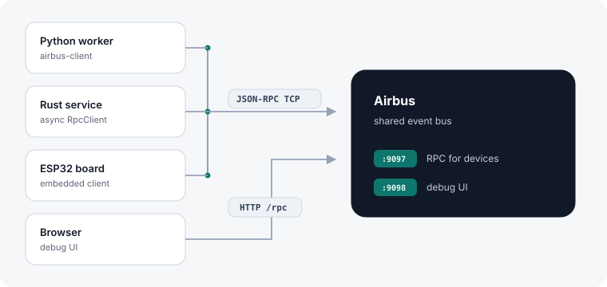

# Airbus

**Airbus** is a small JSON-RPC event bus over TCP. Single daemon (or container): Create named queues, publish events, and attach listeners
that get push deliveries. 
Easy to implement with typed clients for **Python**, **async Rust**, and
**Arduino/ESP32**.

Example use-cases:

- An ESP32 and a Python process on a lab network exchanging sensor readings
over a `full-duplex` queue
- A few local workers competing for jobs on a `fifo` queue.
- Service fan-out (`broadcast`) to several listeners on the same network or machine.



## What you get (and what you don’t)

**Good fit when you want**

- A single binary / container and a JSON-RPC API (schema-backed OpenRPC)
- Named queues with dedicated modes: 
  - fan-out (`broadcast`)
  - competing workers
  (`fifo`)
  - host↔device cross-route (`full-duplex`)
- Push delivery to listeners (daemon dials your port with `on_event` + ack),
retries / timeouts, non-destructive `peek_events`
- The same contract from Python, Rust, or an ESP32 sketch
- A browser debug UI on `:9098`

**Not a substitute for**

- Kafka / Pulsar / large NATS clusters (partitions, retention, multi-DC, ops
tooling)
- RabbitMQ / SQS as a durable enterprise broker (disk persistence, AMQP
ecosystems, cloud SLA)
- Redis Streams as a general-purpose data store

Airbus keeps state **in memory** for the process lifetime. Restart clears
queues. Delivery is best-effort with retries to attached listeners — not
exactly-once log replication. Treat it as a **local/lab/service bus**, not a
durable event store.

Deeper semantics: [Queues & dispatch](docs/queues-and-dispatch.md) ·
[Overview](docs/overview.md).

---


## Getting started


### (Option A) Point your agent here and chat about it

Paste this into your favorite AI Assistent and ask how to adopt Airbus
for your stack:

```text
Check `https://github.com/ghhwer/airbus` and read "docs/agents/README.md" to understand what this is.
I want to chat about this and discuss how this fits into my stack.
```

If you are an agent just go to: [docs/agents/](docs/agents/README.md).

### (Option B) Run it yourself (Docker + Python)

**1. Start the daemon using docker**
[ghcr.io/ghhwer/airbus](https://github.com/ghhwer/airbus/pkgs/container/airbus)):

```bash
docker run --rm -p 9097:9097 -p 9098:9098 ghcr.io/ghhwer/airbus:latest
```

RPC on **9097**, debug UI at [http://127.0.0.1:9098/](http://127.0.0.1:9098/).
Clients default to `127.0.0.1:9097`, or set `AIRBUS_URL` / `AIRBUS_HOST` +
`AIRBUS_PORT`.

**2. Post an event using python** (Python):

```bash
pip install airbus-client
```

```python
from airbus_client import Queue, QueueMode

q = Queue("jobs")          # uses AIRBUS_URL / host+port env
q.create(QueueMode.fifo)
q.attach(lambda e: print(e["event"]))
q.post({"type": "hello"})
```

Other languages: [Rust](docs/clients/rust.md) · [Arduino/ESP32](docs/clients/embedded.md) ·
all clients in `[docs/clients/](docs/clients/README.md)`.

Want to contribute? See [CONTRIBUTING.md](CONTRIBUTING.md).

---

## Docs


| If you are…                              | Start here                                                                                                    |
| ---------------------------------------- | ------------------------------------------------------------------------------------------------------------- |
| Integrating via API / clients            | [Client usage](docs/clients/README.md) · [Queues](docs/queues-and-dispatch.md) · [Protocol](docs/protocol.md) |
| An AI agent helping someone adopt Airbus | `[docs/agents/](docs/agents/README.md)`                                                                       |
| An AI agent contributing to this repo    | [AGENTS.md](AGENTS.md) · [CONTRIBUTING.md](CONTRIBUTING.md)                                                   |


